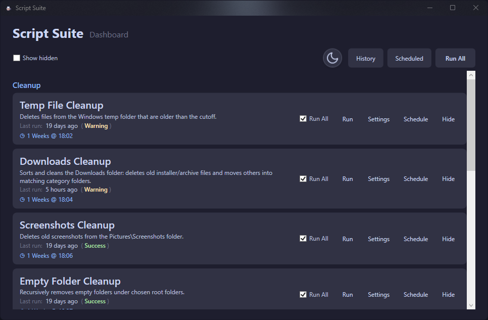
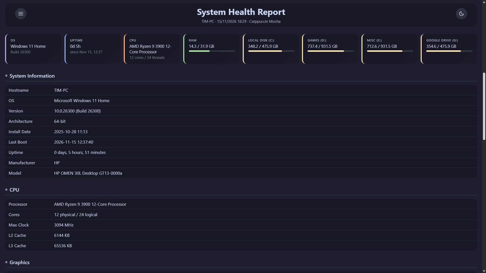

# windows-scripts


[](https://github.com/catppuccin/catppuccin)

A Windows maintenance suite — a WPF dashboard (`ScriptSuite`) over nine self-contained PowerShell scripts for cleanup, system tasks, and diagnostics. For most users it's a normal Windows app (download, unzip, run); for developers the same scripts run directly via PowerShell and the app builds from source.

## Preview



*ScriptSuite dashboard in Mocha dark (966×633) — showing the top Cleanup tiles; Empty Recycle Bin, System, and Reports sections continue below. Each tile shows last-run status and any active schedule (`◷`), plus `Run All` selection and `Run`, `Settings`, `Schedule`, and `Hide` controls. The circular theme toggle (Moon/Sun), `History`, `Scheduled`, and `Run All` buttons (plus `?` help) are in the header.*

## Download — for most users (no SDK needed)

**Latest Release:** [`v4.0.0` — `ScriptSuite v4.0.0`](https://github.com/Bllodwolfie/windows-scripts/releases/tag/v4.0.0)

1. Download [`ScriptSuite-win-x64-self-contained.zip`](https://github.com/Bllodwolfie/windows-scripts/releases/download/v4.0.0/ScriptSuite-win-x64-self-contained.zip) (self-contained `win-x64`, no .NET runtime to install).
2. Right-click the zip → `Extract All` → open the folder.
3. **Primary install method:** Double-click `Install.cmd`. It automatically unblocks downloaded files, bypasses restrictive execution policies, prompts for UAC elevation to install to `%ProgramFiles%\ScriptSuite\` with admin-only write ACLs (SEC-02), creates the Start Menu shortcut (Windows Search → `ScriptSuite`), registers ScriptSuite in Windows **Installed apps** (with `Uninstall.cmd` / `Uninstall.ps1`), and verifies the installation.
   - **Manual fallback:** Open PowerShell and run `powershell -ExecutionPolicy Bypass -File .\Install.ps1`, or run `ScriptSuite.exe` directly as a portable app without installing.
4. **Uninstallation:** Uninstall via Windows **Settings > Installed apps** (or run `Uninstall.cmd` / `Uninstall.ps1`). This removes the app and its scheduled tasks (including uninstalling cleanly from a temp copy when triggered via Installed apps) while keeping `%LOCALAPPDATA%\ScriptSuite` data (`history.db`, configs).

> **First-run SmartScreen & UAC:** The installer and exe are unsigned, so Windows SmartScreen shows "Windows protected your PC" (`More info` → `Run anyway`) and UAC elevation prompts show `cmd.exe` or `powershell.exe` rather than a publisher. The zip comes from GitHub via `Mark of the Web`; double-clicking `Install.cmd` automatically applies `Unblock-File`. No admin needed to run the app itself.

*Requires Windows 10 / 11 (x64). No PowerShell version check — the shipped `scripts\` are bundled with the publish output.*

## Build from source — for developers

**Prerequisite:** [.NET 10 SDK](https://dotnet.microsoft.com/download) (`10.0.x`, `dotnet --version` should print `10.0.400+`). The app builds `ScriptSuite/ScriptSuite.csproj` (`net10.0-windows`, `UseWPF`).

```powershell
git clone https://github.com/Bllodwolfie/windows-scripts.git
cd windows-scripts

# Secure system install: publishes self-contained to %ProgramFiles%\ScriptSuite
# and creates %ProgramData%\Microsoft\Windows\Start Menu\Programs\ScriptSuite.lnk
# Requests one UAC prompt so the installation directory inherits admin-only write ACLs (SEC-02).
.\Install.ps1

# Later
.\Uninstall.ps1   # removes app, scheduled tasks, and shortcut; keeps %LOCALAPPDATA%\ScriptSuite data (history.db, configs)
```

`Install.ps1` runs `dotnet publish -c Release -r win-x64 --self-contained true -o publish` (`publish` is not committed, `**/bin/`, `**/obj/` are gitignored) and copies to the protected system install root `%ProgramFiles%\ScriptSuite\` (per-user data stays at `%LOCALAPPDATA%\ScriptSuite`). When run from an extracted Release zip, `Install.ps1` automatically detects the pre-built files (`-NoBuild`) and installs directly without needing the .NET SDK. Use `-InstallDir` / `-ShortcutPath` to override.

**Run scripts directly (no dashboard):**

```powershell
# If your policy already allows local scripts (RemoteSigned)
.\scripts\SystemHealthReport\SystemHealthReport.ps1

# Fresh Windows (Restricted) — one-off bypass, no permanent change
pwsh -ExecutionPolicy Bypass -File .\scripts\SystemHealthReport\SystemHealthReport.ps1

# From a ZIP download, first unblock
Get-ChildItem .\scripts -Recurse -Filter *.ps1 | Unblock-File
```

## The 9 scripts

Descriptions come from `ScriptSuite/Manifests/*.json` (source of truth for what ships; `v1.0.1` excludes `m12_elevated_test` test scaffolding):

| Script | What it does | Requires admin |
|--------|--------------|----------------|
| [SystemHealthReport](scripts/SystemHealthReport/) | Generates a self-contained HTML report of system health (CPU, memory, disks, network, errors). | No |
| [ClearEventLogs](scripts/ClearEventLogs/) | Backs up and clears all Windows event logs. | **Yes** |
| [DownloadsCleanup](scripts/DownloadsCleanup/) | Sorts and cleans the Downloads folder: deletes old installer/archive files and moves others into matching category folders (including Music, Videos, Pictures, Modeling, Cisco PacketTracer, Spreadsheets, Presentations, Text, and Configuration). Supports `IgnorePatterns`, multiple `SourceDirs`, and Advanced per-extension rules (`Ignore`/`Delete`/`MoveTo`) that override the simple `Extensions to delete` list. | No |
| [EmptyFolderCleanup](scripts/EmptyFolderCleanup/) | Recursively removes empty folders under chosen root folders via a single bottom-up scan. Protects common build and project directories (`.git`, `.svn`, `.hg`, `node_modules`, `vendor`, `.venv`, `venv`, `__pycache__`, `.cargo`, `target`, `bin`, `obj`, `.vs`, `build`, `dist`, `packages`, `.nuget`), skips reparse points (junctions, symlinks, OneDrive placeholders), and supports multiple scan roots. | No |
| [EmptyRecycleBin](scripts/EmptyRecycleBin/) | Permanently empties the Recycle Bin. Deleted files cannot be recovered. Supports “Only delete items older than N days” (`0` = everything). | No |
| [RestorePoint](scripts/RestorePoint/) | Creates a System Restore point and verifies it actually appeared. | **Yes** |
| [ScreenshotsCleanup](scripts/ScreenshotsCleanup/) | Deletes old screenshots from chosen folders (default `Pictures\Screenshots`). Supports multiple `TargetFolders` and `IgnorePatterns`. | No |
| [SoftwareInventory](scripts/SoftwareInventory/) | Generates a text report of all installed software. | No |
| [TempCleanup](scripts/TempCleanup/) | Deletes files from chosen temp folders (default `%TEMP%`) that are older than the cutoff. Supports multiple `TargetFolders` and `IgnoreFolders`. | No |

Defaults live in `ScriptSuite/DefaultConfigs/*.json` and copy to `%LOCALAPPDATA%\ScriptSuite\Configs\` on first run (`AppPaths.cs` `EnsureConfigsSeeded`, never overwrites existing):

- `ClearEventLogs` → `BackupDir: %USERPROFILE%\Documents\Script_Logs\EventLogBackups`, `CutoffDays: 0`
- `DownloadsCleanup` → `SourceDirs: ["%USERPROFILE%\Downloads"]`, `CutoffDays: 7`, `LogDir: %USERPROFILE%\Documents\Script_Logs`, `LogFile: CleanupLog.txt`, `DeleteExts`, `IgnorePatterns: []`, `AdvancedRules: {}`, `Categories` (9 categories including `Documents\Networking\PacketTracer`)
- `EmptyFolderCleanup` → `TargetFolders: ["%USERPROFILE%\Downloads"]`, `IgnoreFolders: []`, `UseDefaultIgnoreNames: true`, `LogDir: %USERPROFILE%\Documents\Script_Logs`, `LogFile: CleanupLog.txt`
- `EmptyRecycleBin` → `MinAgeDays: 0`
- `RestorePoint` → `Description: "Monthly Cleanup"`
- `ScreenshotsCleanup` → `TargetFolders: ["%USERPROFILE%\Pictures\Screenshots"]`, `CutoffDays: 7`, `IgnorePatterns: []`, `LogDir: %USERPROFILE%\Documents\Script_Logs`, `LogFile: CleanupLog.txt`
- `SoftwareInventory` → `OutputFile: %USERPROFILE%\Documents\Script_Logs\Software_Inventory.txt`
- `SystemHealthReport` → `OutputDir: %USERPROFILE%\Documents`, `OutputFile: System_Health_Report.html`, `MaxTopProcesses: 10`, `MaxErrorEvents: 20`, `ErrorWindowHours: 24` (+ Mocha/Latte palettes)
- `TempCleanup` → `TargetFolders: ["%TEMP%"]`, `CutoffDays: 7`, `IgnoreFolders: []`

> [!NOTE]
> **Multi-Root Cleanup Scanning:** `EmptyFolderCleanup`, `TempCleanup`, `ScreenshotsCleanup`, and `DownloadsCleanup` support scanning multiple root folders (`TargetFolders` or `SourceDirs` with backward-compatible single-folder fallback), automatically de-duplicating identical or overlapping nested roots and gracefully skipping inaccessible folders. `EmptyFolderCleanup` also uses a single bottom-up scan, skips reparse points (junctions, symlinks, OneDrive placeholders), and protects standard build and project folders (`.git`, `.svn`, `.hg`, `node_modules`, `vendor`, `.venv`, `venv`, `__pycache__`, `.cargo`, `target`, `bin`, `obj`, `.vs`, `build`, `dist`, `packages`, `.nuget`) by default unless opted out via `UseDefaultIgnoreNames: false`.

Each script supports dry-run preview where `supportsDryRun: true` in its manifest (7 of 9; `SoftwareInventory` and `SystemHealthReport` are reports, not previews).

*Sample `System Health Report` output (Catppuccin Mocha with built-in Mocha/Latte toggle, 1920×1080) — see `assets/preview.png`:*



## Prerequisites

- **For the Release zip:** Windows 10 / 11 x64 only. No .NET runtime, no PowerShell version needed (self-contained).
- **For `scripts\` directly:** Windows 10 / 11, PowerShell 5.1+ (PowerShell 7 recommended).
- **For building:** Windows 10 / 11, .NET 10 SDK (`10.0.x`).

## Scheduling — unattended runs via Task Scheduler

Every script (all 9, including the 2 admin ones) can be scheduled from its tile **Schedule** button or from the **Scheduled Tasks** overview window. The dialog supports `Days`, `Hours`, and `Weeks` intervals:
* **Weekly recurrence & weekday selection:** When `Weeks` is selected, Mon–Sun checkboxes allow choosing any combination of weekdays (at least one required). For multi-week schedules (`Interval > 1`), a start date picker anchors the recurrence week cycle.
* **Daily and hourly start date:** For `Days` or `Hours`, specify an optional start date to anchor recurrence or delay the first execution.
* **Live next run preview:** Displays `"Next run: Ddd dd.MM.yyyy HH:mm"` computed from the exact trigger calculation algorithm.
* **Collision warnings:** Non-blocking warning banner notifies you if another enabled script is scheduled at the same time on overlapping days to avoid `Skipped — app was busy` single-instance mutex conflicts.
* **Two tiers under the hood, one UI:** 7 non-admin scripts register `InteractiveToken Limited` tasks without UAC unless updating an existing admin-owned task returns Access Denied (`0x80070005`); 2 admin scripts (`ClearEventLogs`, `RestorePoint`) register `S4U HighestAvailable` tasks and prompt for UAC once at save. After saving, scheduled runs execute headlessly in the background with no UAC prompts.
* **Per-script risk opt-in:** First time you schedule an admin script, check `I understand the risks` (stored in `%LOCALAPPDATA%\ScriptSuite\risk-consents.json` per-script, persists after unscheduling). This is separate from the **one-time UAC at Save** needed to register a `HighestAvailable` task.
* **Dedicated Scheduled Tasks window:** Header `Scheduled` button opens `Scheduled Tasks` (`ScheduledTasksWindow`), listing all 9 scripts with their active schedule summary (`Active Schedule` badge), last-ran timestamp/outcome, and a `Configure` button for each script.
* **Unified Run History:** Header `History` button opens the unified `Run History` window (`HistoryWindow`), combining manual and scheduled runs in one list with `Manual` / `Scheduled` trigger badges, search, **Trigger** (`All` / `Manual` / `Scheduled`) and **Outcome** filters, pagination (100 rows per page), and expandable per-row log details (`Open log file` / `Open folder`). `SkippedBusy` (`Skipped — app was busy`) is recorded as a distinct outcome (not silently dropped, not queued) when a scheduled trigger fires while the dashboard is open (`Global\ScriptSuite_SingleInstance_<SID>` mutex + file-lock fallback).
* **App remains closed between runs:** Task Scheduler launches `ScriptSuite.exe --scheduled-run <id>` headlessly, runs via `Services/ScriptExecutor.cs` `CreateDefault` (self-contained fix for `PSHOME`/`CimCmdlets` headless), inserts into `history.db` (`RunHistory`, mirrored to `ScheduledRuns` for compatibility), and exits — no tray or background process and no toast notifications.
* **Storage:** Schedules live in `%LOCALAPPDATA%\ScriptSuite\schedules.json` (`Models/ScheduleEntry.cs`), `risk-consents.json`, and `history.db` (`Services/RunHistoryStore.cs`, auto-pruned after 28 days). `Remove Schedule` in the same dialog unregisters the task (`Unregister-ScheduledTask`) and clears the entry (dashboard `◷` indicator `HasSchedule`/`ScheduleSummary` disappears).

## Themes

The dashboard header's circular **Moon/Sun** theme toggle button switches between Catppuccin Mocha (dark, `#1E1E2E`) and Latte (light, `#EFF1F5`) at runtime — no restart required — and persists to `%LOCALAPPDATA%\ScriptSuite\theme.json` (default Dark, so existing installs are unaffected). All windows (Dashboard, Settings, Run, History, Scheduled Tasks, Schedule, and First-Run Wizard) follow the selected palette via `DynamicResource` (`Themes/Tokens.xaml` / `Themes/Tokens.Latte.xaml`), with custom `TextBox`, `ComboBox`, and `ComboBoxItem` control templates bound to theme tokens (`v3.2.3+`) so third-party theming tools (such as Windhawk) do not break control contrast or clipping.

## Help

Contextual `?` buttons appear in the dashboard header (`Script Suite / Dashboard`), each script's Settings window (next to the script name for overview + per-field `?` next to Label/Unit for field-level detail), the Run window (next to the script name), and the Schedule dialog (next to the title). Click to expand a themed panel — not a separate manual. Help is per-field `helpDetail` (manifest) and per-window overview (P0/P1: ClearEventLogs, EmptyRecycleBin, DownloadsCleanup Advanced Rules, Scheduling, Temp/Screenshots/EmptyFolder, RestorePoint, Run window). P2/P3 (History, Dashboard legend, SystemHealthReport, SoftwareInventory, Theme toggle) intentionally have no extra help this pass. First-run wizard reuses `SettingsForm`, so `?` appears there too with no layout break.

## Known limitations & notices

- **Unsigned installer & exe:** The installer and exe are unsigned, so SmartScreen shows "Windows protected your PC" (`More info` → `Run anyway`) and UAC shows `cmd.exe` or `powershell.exe`, not a publisher. No EV cert yet.
- **Uninstallation data retention:** Uninstall via Windows **Settings > Installed apps** (or `Uninstall.cmd` / `Uninstall.ps1`) removes the app and its scheduled tasks (using a temp copy when launched from Installed apps) while keeping `%LOCALAPPDATA%\ScriptSuite` data (`history.db`, configs). Installer and uninstaller logs at `%ProgramData%\ScriptSuite\install.log` and `uninstall.log` are capped at 256 KB.
- **UAC schedule save prompts:** Admin scripts (`ClearEventLogs`, `RestorePoint`) trigger one UAC prompt on schedule save to register `HighestAvailable` tasks; non-admin scripts only elevate on save if overwriting an existing admin-owned task returns Access Denied.
- **SQLite WAL sidecars:** Run history lives at `%LOCALAPPDATA%\ScriptSuite\history.db` (`Services/RunHistoryStore.cs` `journal_mode=WAL`, `busy_timeout=5000`, 28-day retention pruning). Beside it you will see `history.db-wal` / `history.db-shm` — normal for WAL; don't copy the `.db` alone while the app is running (raw `File.Copy` would miss uncheckpointed WAL data).
- **SEC-03 (Config & temp interchange scope):** Elevated runs read user-writable configs from `%LOCALAPPDATA%\ScriptSuite\Configs` and exchange temporary IPC files via `%TEMP%`. Mitigated by `Test-PathScope` and schema validation; not architecturally isolated.
- **SEC-04 (Configuration Trust System):** All configuration files in `%LOCALAPPDATA%\ScriptSuite\Configs` are protected by a SHA-256 trust store (`%LOCALAPPDATA%\ScriptSuite\config-trust.json`). Saving settings via the application UI automatically approves the configuration. If a configuration file is edited by hand, swapped, or imported, it is marked untrusted until reviewed:
  - **Interactive Execution & Scheduling:** Prompts with a modal review dialog displaying the planned action summary, targeted paths, and patterns before a live run or schedule creation/edit can proceed (Cancel is the default; dry-run preview is exempt).
  - **Headless & Elevated Execution:** Headless tasks (`--scheduled-run` and `--elevated-run`) strictly reject untrusted configs without prompting, record a `Failed` entry in `history.db` with `"Config not trusted; open ScriptSuite and review it"`, and exit with code 1. Elevated child processes re-verify config trust independently.
  - **Scope Protection:** Combined with `Test-PathScope` path denylisting (blocking drive roots, system/program directories, user profile roots, and data roots), external or malicious config modifications cannot silently manipulate files. Scripts without dry-run (`SoftwareInventory`, `SystemHealthReport`) require an explicit "Run" click showing resolved output paths instead of executing automatically on window load.
- **UAC save flow testing:** The interactive UAC elevation prompt during schedule saving is hand-tested only; automated regression suites simulate the elevation helper return codes and Win32 cancellation via internal seams.
- **Unreleased (`dev`) vs v4.0.1:** Multi-folder scanning support extended to `TempCleanup`, `ScreenshotsCleanup`, and `DownloadsCleanup` (`TargetFolders` and `SourceDirs` with backward-compatible single-folder fallback, deduplication, and nested root elimination).
- **v4.0.1 vs v4.0.0:** Documentation lists the complete built-in protected ignore list for `EmptyFolderCleanup`.
- **v4.0.0 vs v3.2.3:** Dedicated `Scheduled Tasks` window; unified `Run History` with search, Trigger/Outcome filters, and pagination; Windows **Installed apps** registration (`Uninstall.cmd` / `Uninstall.ps1` alongside the app, uninstalling from a temp copy); `EmptyFolderCleanup` multi-folder scanning, single bottom-up scan, `UseDefaultIgnoreNames` built-in protected folder list, and reparse-point skipping; `DownloadsCleanup` Cisco PacketTracer category; 256 KB installer/uninstaller log cap; and fixes for paths containing spaces and installer exit hangs.
- **v3.2.3 vs v3.2.2:** Custom `TextBox`, `ComboBox`, and `ComboBoxItem` control templates bound to theme tokens for compatibility with third-party theming tools (e.g., Windhawk), and fix for History search box text clipping.
- **v3.2.2 vs v3.2.1:** Reliable installation experience: added `Install.cmd` for zero-setup execution policy bypass and Mark-of-the-Web unblocking; fixed Windows PowerShell 5.1 parameter initialization crash by resolving script paths in script body; prebuilt-exe mode operates without project or .NET SDK dependencies; persistent installation and uninstallation logs written to `%ProgramData%\ScriptSuite\install.log` and `uninstall.log`; launcher waits for elevated installer and reports unified PASS/FAIL status; and comprehensive isolated regression test suite.
- **v3.2.1 vs v3.2.0:** Stricter task registration, elevation escalation restricted strictly to proven access denied (eliminating false-positive elevation), elimination of unregister-before-register in favor of atomic replacement via `Register-ScheduledTask -Force`, UI CLIXML error sanitization, extended 120s elevated timeout with read-back verification, and expanded test coverage.
- **v3.2.0 vs v3.1.2:** Schedule control (multi-weekday selector, multi-week anchor date, start date picker, live next-run preview, collision warnings, strict XML trigger verification, and seamless elevation fallback for admin-owned tasks).
- **v3.1.2 vs v3.1.1:** Remove `--config-path` CLI parameter completely; elevated executions unconditionally resolve configuration files through canonical AppData paths.
- **v3.1.1 vs v3.1.0:** Remove external configPath parameter from trust store, support LOCALAPPDATA redirection for test isolation, and auto-trust default configs upon fresh seeding.
- **v3.1.0 vs v3.0.3:** SEC-04 (Configuration Trust System: SHA-256 trust store, interactive approval dialog, headless rejection with exit 1, child re-verification), audit hardening (removal of test elevation override, restoration of original file encodings, validation of all category destinations, and dynamic SoftwareInventory extension derivation), and non-dry-run explicit execution.
- **v3.0.0 vs v2.1.1:** SEC-02 (install to %ProgramFiles% with admin write ACLs, task migration, one-time UAC prompt on install), SEC-01 (elevated run script ID validation), DST fix (local StartBoundary on triggers, eliminating 1-hour drift), and bug fixes BUG-01..09 (BUG-01 hourly scheduler, BUG-02 retention validation, BUG-04 extension dot normalization, BUG-05 pattern escaping, BUG-06 quote stripping, BUG-07 path scope decoupling, BUG-08 update metric relabel, BUG-09 restore point fast-fail). Full details in [CHANGELOG.md](CHANGELOG.md).
- **v2.0.0 vs v1.1.0:** Dark palette unchanged (Phase 1). `v2.0.0` adds 3 UI fixes (Scheduled History rendering, collapsible Run All preview, log-routed history detail), Downloads Cleanup `Advanced Rules` (Ignore/Delete/MoveTo) + its `MoveTo`-empty-destination validation, EmptyRecycleBin `MinAgeDays` (0 = everything, filtered via `DateDeleted`), Light Mode Dark/Latte runtime switch (persisted), and Help/Guide P0+P1 contextual `?`.
- **v1.1.0 vs v1.0.1:** `v1.0.1` shipped 9 scripts (excluded `m12_elevated_test` via `ScriptSuite.csproj`). `v1.1.0` adds scheduling (engine, `S4U` split, `ScheduledRuns` separate table, mutex `SkippedBusy`, UI `Schedule`/`Scheduled History`). No behavior change for manual runs.

## License

MIT — see [LICENSE](LICENSE) (Copyright (c) 2026 Bllodwolfie).
